# CineBook class diagram

Paste the code block below into https://mermaid.live, then use **Actions > PNG / SVG** to export.
This diagram matches the classes in `src/models/` exactly.

```mermaid
classDiagram
    class Movie {
        +string id
        +string title
        +string synopsis
        +string[] genres
        +number durationMinutes
        +number rating
        +number fameScore
        +string releaseDate
        +string status
        +string posterUrl
        +string backdropUrl
        +string[] cast
        +string[] showtimeIds
        +getFormattedDuration() string
        +isBookable() boolean
        +getBasePrice() number
    }
    class Cinema {
        +string id
        +string name
        +string location
        +string address
        +string[] auditoriumIds
    }
    class Auditorium {
        +string id
        +string cinemaId
        +string name
        +number rows
        +number seatsPerRow
        +number premiumRows
        +string[] seatIds
        +getSeats() Seat[]
        +getCapacity() number
    }
    class Seat {
        +string id
        +string row
        +number number
        +string type
        +isAvailable(occupiedIds) boolean
    }
    class Showtime {
        +string id
        +string movieId
        +string cinemaId
        +string auditoriumId
        +string date
        +string startTime
        +number ticketPrice
        +string[] seatIds
        +string[] occupiedSeatIds
        +getStartDate() Date
        +isAvailable(now) boolean
        +getFormattedDateTime() string
    }
    class Booking {
        +string id
        +string bookingReference
        +string movieId
        +string cinemaId
        +string showtimeId
        +string showDate
        +string startTime
        +string[] selectedSeatIds
        +number ticketQuantity
        +number subtotal
        +number fees
        +number totalPrice
        +string status
        +string createdAt
        +calculateSubtotal(ticketPrice) number
        +calculateTotal() number
        +confirm() void
        +cancel() void
        +isConfirmed() boolean
        +toJSON() object
        +fromJSON(data)$ Booking
        +generateId()$ string
        +generateReference(existing)$ string
    }
    class User {
        +string id
        +string name
        +string email
        +string[] bookingIds
        +addBooking(bookingId) void
    }

    Cinema "1" *-- "3..*" Auditorium : contains
    Auditorium "1" *-- "1..*" Seat : composed of
    Movie "1" o-- "0..*" Showtime : scheduled as
    Showtime "*" --> "1" Cinema : held at
    Showtime "*" --> "1" Auditorium : screened in
    Showtime "1" --> "1..*" Seat : offers
    Booking "*" --> "1" Showtime : for
    Booking "*" --> "1" Movie : of
    Booking "*" --> "1" Cinema : at
    Booking "*" --> "1..6" Seat : reserves
    User "1" o-- "0..*" Booking : owns
```

Allowed string values (constants in `src/constants.js`):
- `Movie.status`: `NOW_SHOWING`, `COMING_SOON`
- `Seat.type`: `STANDARD`, `PREMIUM`
- `Booking.status`: `PENDING`, `CONFIRMED`, `CANCELLED`

## Design notes (for your defense)

- **Seat has no `status`.** A physical seat (A1) is the same object for every showtime, but whether it is taken depends on the showtime. Occupancy lives on `Showtime.occupiedSeatIds` (demo seed) plus seats of CONFIRMED bookings. Cancelling a booking frees its seats automatically.
- **`Movie.showtimeIds` is derived** from the showtime data in `movieService.js`, so it is never typed by hand.
- **`Auditorium` is composed of `Seat`s** generated from `rows` and `seatsPerRow`.
- **`Booking.showDate` / `startTime`** are snapshots so an old ticket still shows its date after the demo schedule moves on.

## How to verify the diagram against the code

1. Open each file in `src/models/`. Every property assigned in a `constructor` must appear in the matching class box.
2. Every method (and `static` method, marked `$`) in the file must appear in the box.
3. Every `...Id` property is a relationship: check there is a matching arrow.
4. Multiplicities: 3 auditoriums per cinema (`data/auditoriums.js`), max 6 seats per booking (`MAX_SEATS_PER_BOOKING`).
